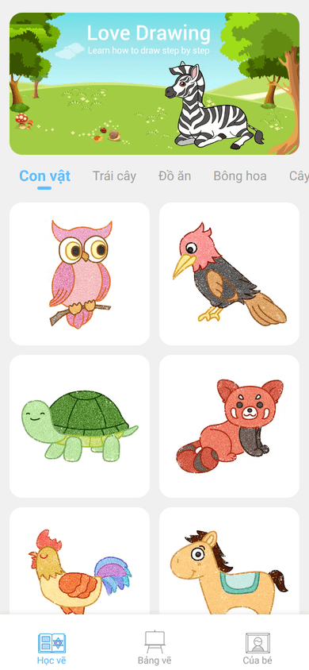
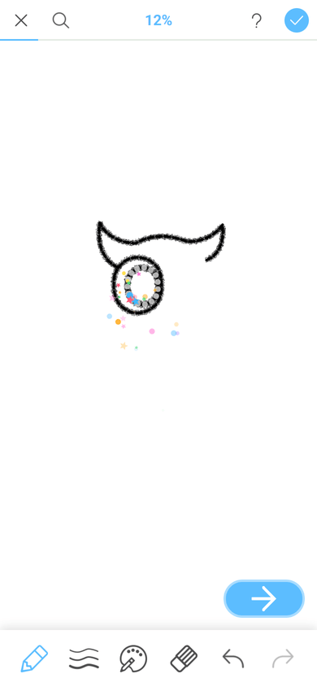
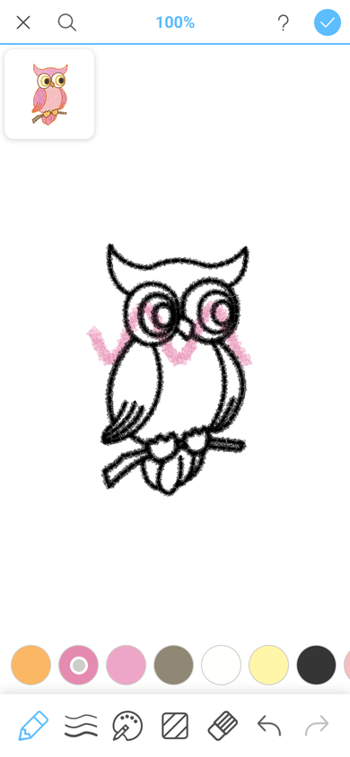
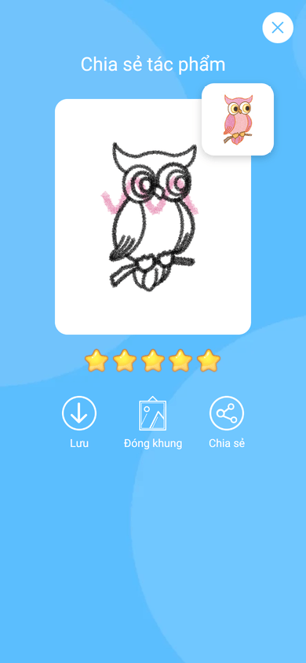
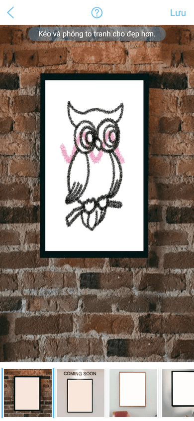
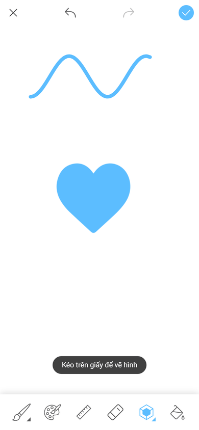

# Bé Học Vẽ

Bé học vẽ từng nét theo hướng dẫn, tô màu rồi treo tranh lên tường, ngay trên trình duyệt. Chạy được trên điện thoại, máy tính bảng và máy tính.

**Chơi ngay:** https://shovity.github.io/kids-learn-to-draw/

| Chọn tranh | Vẽ theo nét | Tô màu | Chia sẻ | Treo tranh | Bảng vẽ |
| --- | --- | --- | --- | --- | --- |
|  |  |  |  |  |  |

## Tính năng

Giao diện và luồng chơi bám sát app gốc: dùng lại ảnh nút, icon, ngôi sao, banner, khung tranh và hình khối trích từ APK.

- **64 tranh**, 8 chủ đề: con vật, trái cây, đồ ăn, bông hoa, cây cối, xe cộ, thời trang, đồ vật.
- **Vẽ theo nét:**
  - Lúc đầu hiện cả tranh mẫu và nút *Bắt đầu*.
  - Mỗi lần bấm ➜, một nét mới hiện dần kèm bàn tay chỉ đường. Các nét đã qua thành nét đứt màu đen.
  - Dọc nét đang vẽ có chấm xanh. Bé vẽ đi qua chấm nào thì chấm đó chuyển xám và bắn pháo hoa.
  - Tiến độ hiện ở giữa thanh trên (0–100%).
- **Tô màu:**
  - Hiện hết nét thì bấm ➜ lần nữa để sang tô màu.
  - Có hàng màu lấy từ tranh mẫu, thẻ tranh mẫu ở góc, chọn màu nền.
  - 6 kiểu cọ: bút chì, sáp màu, sáp mềm, bút lông dẹt, bút máy, cọ phun.
  - 12 cỡ cọ, bảng chọn màu (vòng màu, đậm nhạt, độ trong), tẩy, hoàn tác/làm lại.
- **Kính lúp** phóng to chỗ đang vẽ. Hai ngón tay để kéo và phóng to tranh.
- **Chia sẻ tác phẩm:**
  - Chấm 0–5 sao theo số chấm xanh đã chạm.
  - Lưu ảnh, chia sẻ, hoặc đóng khung (15 phòng/khung).
- **Bảng vẽ tự do:** 5 cây bút, 30 hình khối (đặc/viền), màu nền hoặc ảnh nền.
- **Của bé:** có hai mục *Đang vẽ* và *Đã xong*. Nhấn giữ một tranh để vẽ lại, xoá hoặc chia sẻ.
- Tranh lưu ngay trên máy (IndexedDB), không cần tài khoản.

## Nguồn gốc

Đây là bản web dựng lại từ ứng dụng Android *Learn to draw* (`com.love.drawing.draw` 3.7). App gốc được phân tích bằng [REA](https://github.com/morluto/rea) (JADX headless + apktool):

- `PaintActivity` / `DrawingBoardView`:
  - Nút Start/Next gọi `W()`: hiện nét kế tiếp trong 1 giây, rồi rải chấm dọc nét.
  - Chấm điểm `getScore()` ra 0–5 sao.
  - Kiểu cọ `V = 0..5`.
  - Sang tô màu sau nét cuối.
- Layout `activity_paint`, `dialog_brush_size`, `dialog_paint_style`, `dialog_color_pick`, `dialog_draw_done`, `dialog_continue_or_restart`, `fragment_coor_home`, `activity_whiteboard`, `activity_decorate`, `activity_new_setting`: kích thước, màu (#5cbdff, #f0f0f0) và bố cục.
- Tài nguyên:
  - SVG tranh mẫu: nhóm `block` là vùng màu, nhóm `line` là nét.
  - Ảnh mẫu, khung trang trí, mẫu đầu cọ, ảnh giao diện và ảnh động của thanh tab.

Không đưa vào bản web: quảng cáo, mua trong ứng dụng, vòng quay xu, phần "AI style" (vốn cần máy chủ) và chế độ vẽ ra giấy.

## Chạy ở máy

```bash
npm install
npm run dev        # http://localhost:3000
npm test           # vitest
npm run typecheck
npm run build      # xuất trang tĩnh ra out/
```

`npm run assets` tạo lại `public/` và `lib/*.json` từ APK đã giải nén trong `apk/`. Thư mục `apk/` không được commit.

## Deploy

Mỗi lần push lên `master`, workflow [`.github/workflows/deploy.yml`](.github/workflows/deploy.yml) build bản tĩnh (`output: "export"`) với `NEXT_PUBLIC_BASE_PATH=/kids-learn-to-draw` rồi deploy lên GitHub Pages. Đường dẫn tới file trong `public/` phải đi qua `asset()` / `ui()` trong `lib/manifest.ts`.
